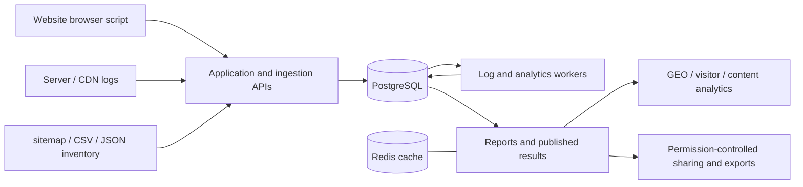

# GEOInflow

**English** | [简体中文](README.zh-CN.md) | [繁體中文](README.zh-TW.md)

Self-hosted web and AI crawler analytics for Generative Engine Optimization (GEO).

**Jointly published by 猎看科技 · 北京日报社智源GEO**

[Quick start](docs/getting-started.en.md) · [Deployment](docs/deployment.en.md) · [AI crawler analytics](docs/ai-crawler-analytics.md) · [Architecture](docs/system-overview.md) · [Documentation](docs/README.md) · [Contributing](CONTRIBUTING.md)

GEOInflow brings website visitors, AI search referrals, server crawl logs, and content inventories into a shared website context. It helps teams understand which AI crawlers visit their sites, which pages they request, which important pages have no observed crawl activity, where requests fail, and how AI search contributes visitors and conversions.

The system includes browser tracking, account permissions, GEO reports, crawler evidence, log collection, and analytics acceleration. The current product version is **v1.2**, with build version **1.2.0**. Application source code is distributed under the [MIT license](LICENSE).

Quick start and deployment guides are available in English and Simplified Chinese. Other linked reference guides are currently in Simplified Chinese.

## Introduction video

https://github.com/user-attachments/assets/81e57cc4-3441-4e5f-b2fb-cd929c6c27bd

## What you can use it for

| Question | Available data | Actions it can inform |
| --- | --- | --- |
| Which AI platforms visit the site? | Crawler identity, purpose, provider, request volume, verification status, and trends | Distinguish training, search, and user-triggered requests to understand how content is accessed |
| Which pages are crawled repeatedly? | Page rankings, repeat requests, directory distribution, and recent activity | Review frequently requested paths, invalid URLs, and content structure |
| Have important pages been crawled? | Import sitemap / CSV / JSON inventories and compare them with observed logs | Check entry points, internal links, robots rules, and responses |
| Are crawler requests succeeding? | HTTP status, GET / HEAD, caching, latency, errors, and risk signals | Investigate blocked requests, origin errors, coverage drops, and source interruptions |
| What does AI search bring to the site? | AI referral sessions, landing pages, goals, and conversions | Observe changes in real traffic and business outcomes |
| Is there enough evidence for a conclusion? | Identity evidence, source coverage, gaps, missing inputs, and estimates | Review results over the same data scope and keep evidence gaps explicit |

GEOInflow is designed for company websites, content sites, media publishers, developer documentation, and GEO teams managing multiple sites. Operators can work at the website and page level, while maintainers can inspect ingestion, queues, source quality, and calculation methods.

## AI crawler analytics

### Crawler identity and purpose

The built-in catalog covers OpenAI, Anthropic, Perplexity, Google, Microsoft, ByteDance, Baidu, Kimi, Tencent Hunyuan, and other providers. It also retains observations of traditional search crawlers and other bots.

The catalog records platforms, products, and request identities separately. Training, AI search, and user-triggered access describe request purposes; AI workbenches and personal agents describe product types. These dimensions can overlap. Active entries depend on the administrator-published catalog and each website's configuration.

Declared User-Agent strings, matches against official IP ranges, and available DNS or trusted edge evidence are stored independently. A User-Agent claim alone is insufficient to confirm a source. Historical records without verification evidence retain an unknown status.

### Crawl activity and content coverage

Review requested-page rankings, observed pages, repeated requests, directory distribution, leading crawlers, recent activity, and content freshness. Import a content inventory to measure observed crawl coverage and AI blind spots against a known set of pages.

Identity, purpose, and product-type filters apply before aggregation and pagination. Cards, tables, comparisons, and exports use the same conditions. Path observations and inferred results retain their estimate labels.

### Investigate access problems with evidence

HTTP responses, caching, latency, response bytes, collection continuity, and risk findings are shown separately. Teams can record handling status, notes, deferrals, and resumptions, then review the relevant time windows and evidence.

Access policies support robots / Nginx configuration exports. Supported Cloudflare controls require separate Zone credentials, a preview, explicit confirmation, background execution, and a read-back of the remote state. Provider plans, permissions, and available fields must be checked in the deployed environment.

### AI referrals and business outcomes

Browser tracking recognizes supported AI search referrals and combines them with landing pages, events, goals, and conversions. Crawler requests, referral sessions, and conversions are measured separately. Cross-source associations retain their comparability limits.

**Crawl logs establish observed access. Indexing, model training, answer citations, recommendation rankings, and customer acquisition each require their own evidence.**

See the [AI crawler analytics guide](docs/ai-crawler-analytics.md) for metrics, workflows, and limitations.

## Website analytics

| Capability | Scope |
| --- | --- |
| Pageviews and visitors | PV, UV, visits, referrals, geography, devices, browsers, and content performance |
| Events and conversions | Custom events, goals, funnels, visitor paths, attribution, and revenue analysis |
| Extended analysis | Search engines, referral keywords, UTM, performance, heatmaps, retention, and audiences |
| Collaboration | Websites, personal and team spaces, permissions, workspaces, dashboards, and public sharing |
| Exports | CSV / JSON / ZIP for the selected scope, preserving fields, states, and sensitive-data handling |
| AI assistance | Optional model connections and conversations based on website facts, disabled by default |
| Operations and governance | Ingestion checks, historical data repair, analytics acceleration, and source and rule versioning |

The application supports Traditional Chinese (Taiwan, default in GEOInflow TW), Simplified Chinese and English. The main date ranges are Today / 7 days / 30 days, and the default analytics timezone is `Asia/Taipei`. The first full sign-in confirms the country and city timezone; later requests use the account's saved timezone to define today. Realtime visitors cover the most recent 30 minutes, and retention uses calendar months.

Browser metrics share a common traffic-quality policy. Empty data, missing integrations, unknown values, estimates, and unsupported capabilities are shown as distinct states. Demo websites are explicitly labeled. See [page coverage](docs/ui-coverage.md) for the feature matrix and [date ranges and timezones](docs/date-ranges.md) for date definitions.

## How data enters the system



The browser script collects pageviews, events, and enabled extended data. Server and CDN logs add crawler requests that do not run browser scripts. Content inventories provide a known set of pages. Each input can be connected independently, and the corresponding analysis states its limitations when a source is missing.

Log processing retains sources, classifications, and verification evidence. Analytics workers use pre-aggregation, exact visit facts, and durable results to reduce repeated calculations. Standard dashboards and heavier analysis have separate admission controls. Frequently used ranges are prewarmed, and published results remain available during background updates. See the [architecture guide](docs/system-overview.md).

## Quick deployment

Start Docker Engine / Docker Desktop and Docker Compose V2, and ensure that image and dependency download sources are reachable. After obtaining the source code, run this command from the project root:

```sh
sh scripts/liekan-deploy.sh
```

The script generates a private `.env` and random secrets, builds the application image, runs migrations, imports the bundled official example on a fresh installation, and starts the application, log worker, analytics worker, PostgreSQL, and Redis. The default address is:

```text
http://127.0.0.1:3002
```

For a fresh installation, the initial username is `admin` and the initial password is `liekan`. Change the password after signing in, then create a website using the ingestion guide. Upgrades preserve existing customized passwords and accounts.

Docker startup imports the complete sanitized official example after migrations. For manual development, run:

```sh
docker compose -f docker-compose.liekan.yml exec app node scripts/liekan-seed-demo.mjs
```

The example is named “猎看官网（示例数据）”. The source and Docker image include its complete sanitized dataset, catalog, and checksum manifest, covering browser events, performance, revenue, heatmaps, replays, crawler evidence, content, and goals. On first import, its timestamps are shifted to make the data convenient to explore. Repeated runs preserve existing data and deletion state. See the [default demo guide](docs/default-demo.md).

Production access requires a domain, HTTPS, and a trusted reverse proxy. Raw browser receipt remains observable without trusted IP ingress. Qualified browser metrics, including PV and UV, require usable identity evidence. Automatic log ingestion and optional AI analysis have separate configuration requirements.

The [deployment guide](docs/deployment.en.md) covers services, configuration, proxies, backups, and upgrades. The [quick start](docs/getting-started.en.md) explains how to connect the first website.

## Keeping analytics current

The main Today dashboards read published results every 30 seconds and show the actual data cutoff. Reads pause while the page is hidden or offline. Realtime visitors use their own refresh interval, while heavier analyses such as heatmaps and retention use longer background windows.

Completed results use browser, process, Redis, and PostgreSQL persistence. Common date ranges and pages share query conditions. Capacity safeguards govern eviction of older windows, idle failed tasks pause automatic retries, and initial calculations can finish through durable background tasks. Updates retain statistics permissions and checks for source quality, dates, and rule versions.

Initial calculations, cache hits, and background updates have different costs. Actual performance depends on data volume, coverage construction, the database, and cache state. After deployment, the Analytics Acceleration page shows tasks and coverage. See [analytics acceleration](docs/analytics-acceleration.md) and [caching](docs/analytics-cache.md).

## Self-hosting and scope

- Core website analytics and crawler identification can run on your own infrastructure without a model API key.
- Browser tracking is cookieless by default. Optional recording, event properties, and business integrations use the data scope configured for each deployment.
- AI analysis is disabled by default. When enabled, users choose model connections and website materials. See the [AI configuration guide](docs/ai.md) for the data sent to models.
- GEO Weight is in Beta. It uses qualified AI content access from the most recent 30 complete calendar days, with a documented formula, evidence, and limitations. The [weight guide](docs/geo-weight.md) defines the fixed policy and applicable scope.
- GEO extensions, supplemental journeys, complete exports, and analytics acceleration primarily target PostgreSQL. Retained ClickHouse, link, and pixel endpoints follow their existing protocols; support for each GEO extension must be checked separately.
- Automatic server collection requires public HTTPS, an ingestion secret, and signed installation assets. Cloudflare integration also requires OAuth, permissions, and the relevant provider capabilities.
- Search impressions, actual rankings, model-answer citations, training inclusion, and article completion rates require additional data. The detailed guides define the observations and scores this project provides.

## Development and maintenance

Development uses Node.js **22.23.4**, pnpm **12.3.4**, and PostgreSQL. Prepare an independent database and private configuration using the [deployment guide](docs/deployment.en.md), then run the following commands. This example uses the separate development port `3302`:

```sh
pnpm install --frozen-lockfile
pnpm build:db
pnpm db:migrate
pnpm liekan:migrate
pnpm liekan:queue-bootstrap
pnpm build:openapi
pnpm build:packages
pnpm build:tracker
pnpm build:recorder
pnpm liekan:build-worker
pnpm dev --port 3302
```

Start the log and analytics workers in separate terminals as described in [CONTRIBUTING.md](CONTRIBUTING.md). Development workers and the web application use the same private environment configuration.

Product pages live in `src/components/liekan`, data contracts in `src/lib/liekan/contracts`, and upstream query and permission adapters in `src/lib/liekan/upstream`. New structures use incremental project migrations. Applied migrations remain immutable. The `liekan` technical identifiers, collection protocols, and existing workspace package names retain compatibility.

For issue reports, contributions, scoped verification, and upstream synchronization, see [Contributing](CONTRIBUTING.md), the [documentation index](docs/README.md), and [upstream maintenance](docs/upstream-upgrade.md).

## License and notices

GEOInflow application source code and project documentation use the [MIT license](LICENSE), permitting use, modification, and redistribution, including commercial use, subject to its notice requirements. The full license text governs these permissions.

GEOInflow is jointly published by 猎看科技 and 北京日报社智源GEO. Original copyright and license text are retained with the source. See the [upstream notes](docs/upstream.md) for the project's origin and compatibility relationship.

Dependencies, fonts, and geographic datasets retain their own licenses. See [third-party notices](THIRD_PARTY_NOTICES.md). The default geographic dataset is DB-IP City Lite, with its attribution and CC BY 4.0 license retained. Supplied MaxMind or other geographic databases must comply with their respective data terms. Runtime configuration, real visitor data, database backups, private keys, and privately supplied geographic databases are outside the source release.
