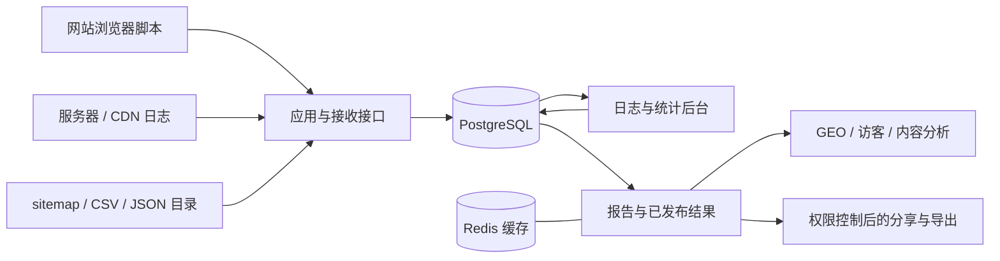

# GEOInflow

[English](README.md) | **简体中文** | [繁體中文](README.zh-TW.md)

面向 GEO 的自托管网站与 AI 爬虫分析系统。

**联合发布：猎看科技 · 北京日报社智源GEO**

[快速开始](docs/getting-started.md) · [部署指南](docs/deployment.md) · [AI 爬虫分析](docs/ai-crawler-analytics.md) · [系统架构](docs/system-overview.md) · [文档目录](docs/README.md) · [参与贡献](CONTRIBUTING.md)

GEOInflow 将网站访客、AI 搜索引荐、服务器抓取日志和内容目录放在同一个网站上下文中，帮助团队回答这些问题：哪些 AI 蜘蛛访问了网站，访问了哪些内容，哪些关键页面长期缺少抓取记录，访问是否遇到错误，以及 AI 搜索实际带来了多少访客和转化。

GEOInflow 提供浏览采集、账号权限、GEO 统计界面、爬虫证据、日志采集和统计加速。当前产品版本为 **v1.2**，工程版本为 **1.2.0**。应用源码采用 [MIT 许可证](LICENSE)。

## 产品介绍视频

https://github.com/user-attachments/assets/2fc24a2c-b8d1-4bb2-ad4d-1229eb1c4796

## 用它做什么

| 你关心的问题 | 可以查看的内容 | 可以据此安排的工作 |
| --- | --- | --- |
| 哪些 AI 平台在访问网站 | 爬虫身份、用途、厂商、请求量、核验状态和趋势 | 区分训练、搜索、用户触发等访问，了解内容被访问的方式 |
| 哪些内容被反复抓取 | 页面排行、重复抓取、目录分布、最近访问 | 检查高频路径、无效 URL 和内容组织方式 |
| 关键内容有没有抓取记录 | 导入 sitemap / CSV / JSON，与观察日志核对覆盖 | 排查入口、内部链接、robots 和响应问题 |
| 蜘蛛访问是否正常 | HTTP 状态、GET / HEAD、缓存、耗时、错误及风险线索 | 定位访问受阻、源站错误、覆盖下降和来源中断 |
| AI 搜索带来了什么 | AI 引荐会话、落地页、目标与转化 | 观察实际访问和业务效果的变化 |
| 数据是否足以支持结论 | 身份证据、来源覆盖、缺口、缺失与估算状态 | 按相同数据范围复核，保留证据不足的结论 |

适用于企业官网、内容站点、媒体网站、开发者文档和为多个网站提供服务的 GEO 团队。日常运营可从网站和页面维度查看，部署维护者可继续检查接入、队列、来源质量与计算依据。

## AI 爬虫分析

### 身份与用途分别展示

内置爬虫目录覆盖 OpenAI、Anthropic、Perplexity、Google、Microsoft、字节跳动、百度、Kimi、腾讯混元等平台，并保留传统搜索和其他爬虫观察。

目录区分平台、产品和请求身份；训练、AI 搜索、用户触发属于用途维度，AI 工作台和个人 Agent 属于产品形态维度。两个维度可以有交集，实际启用项以管理员发布的目录及网站配置为准。

请求声明的 User-Agent、官方 IP 范围匹配及已接入的 DNS / 可信边缘证据独立保存。普通 UA 声明不足以确认真实来源，缺少历史核验证据的记录保留未知状态。

### 抓取与内容关联

可以查看抓取页面排行、覆盖页面、重复抓取、目录分布、主力蜘蛛、最近访问及内容新鲜度。导入内容目录后，可以按已知页面集合检查观察到的抓取覆盖与 AI 盲区。

身份、用途和产品形态条件在聚合与分页前应用，卡片、列表、对比与导出共用相同条件。路径观察和推断结果保留其估算标记。

### 从访问异常追到可用证据

HTTP 响应、缓存、耗时、响应字节、采集连续性和风险发现分别展示。可以记录处理状态、备注、暂缓与恢复，核对历史发生窗口及相关证据。

访问策略提供 robots / Nginx 配置导出；已支持的 Cloudflare 控制需要独立 Zone 凭据，并经过预览、明确确认、后台执行和远端回读。提供方套餐、权限和字段可用性需要在实际环境确认。

### 观察 AI 引荐与业务效果

浏览器采集识别已支持的 AI 搜索引荐来源，结合落地页、事件、目标和转化分析实际访问。爬虫请求、引荐会话和转化分别计量，跨来源的关联结果保留可比性限制。

**抓取记录能说明观察到的访问行为；收录、模型训练、回答引用、推荐排名和获客效果需要各自的证据。**

详细指标、使用步骤和边界见 [AI 爬虫分析指南](docs/ai-crawler-analytics.md)。

## 完整的网站统计

| 能力 | 范围 |
| --- | --- |
| 浏览与访客 | PV、UV、访问、来源、地域、设备、浏览器及内容表现 |
| 事件与转化 | 自定义事件、目标、漏斗、访问路径、归因和收入分析 |
| 扩展分析 | 搜索引擎、来源关键词、UTM、性能、热力图、留存及人群 |
| 协作 | 网站、个人和团队空间、权限、工作台、看板与公开分享 |
| 导出 | 按实际范围导出 CSV / JSON / ZIP，保留字段、状态和敏感信息处理 |
| AI 辅助 | 可选模型连接与基于网站事实的分析对话，默认关闭 |
| 运维与治理 | 接入检查、历史数据修复、统计加速、来源与规则版本管理 |

界面支持繁体中文（台湾，GEOInflow TW 默认）、简体中文与英文。主要统计入口为“今天 / 7 天 / 30 天”，默认分析时区为 `Asia/Taipei`。首次完整登录确认国家和城市时区，之后按账户保存的时区定义今天。实时访客采用最近 30 分钟，留存分析采用自然月。

浏览指标使用统一的流量质量策略。空数据、未接入、未知、估算和未支持分别展示。演示站带有明确标识。功能支持矩阵见 [页面覆盖](docs/ui-coverage.md)，日期定义见 [日期与时区](docs/date-ranges.md)。

## 数据怎样进入系统



浏览器脚本采集浏览访问、事件及已启用的扩展数据。服务器日志与 CDN 日志补充未执行脚本的抓取请求；内容目录提供已知页面集合。三个入口可以独立接入，缺少某一来源时，对应分析会说明限制。

日志处理保存来源、分类和核验证据；统计后台使用预聚合、精确访问事实与持久结果减少重复计算。普通看板与重分析采用独立准入，常用范围预热，已发布结果可在后台更新时继续展示。具体设计见 [系统架构](docs/system-overview.md)。

## 快速部署

准备已启动的 Docker Engine / Docker Desktop、Docker Compose V2，以及可访问镜像和依赖下载源的网络。在取得源码并进入项目根目录后执行：

```sh
sh scripts/liekan-deploy.sh
```

脚本会生成私有 `.env` 与随机密钥，构建应用镜像，执行迁移，首次安装时自动导入完整官方示例，并启动应用、日志后台、统计后台、PostgreSQL 和 Redis。默认访问：

```text
http://127.0.0.1:3002
```

首次安装的初始账号为 `admin`，初始密码为 `liekan`。登录后修改密码，再按接入指南创建网站。已有自定义密码和账号在升级时保留。

Docker 首次启动在迁移后自动导入官方示例。手动开发时可执行：

```sh
docker compose -f docker-compose.liekan.yml exec app node scripts/liekan-seed-demo.mjs
```

示例名称为“猎看官网（示例数据）”。源码与镜像携带完整脱敏数据包、目录和校验清单，覆盖浏览、性能、收益、热力图、回放、抓取证据、内容和目标；首次导入平移时间便于查看，重复运行保留已有数据与删除、清空状态。详情见 [默认示例说明](docs/default-demo.md)。

生产访问需配置域名、HTTPS 与可信反向代理。原始浏览接收情况在缺少可信 IP 入口时仍可观察；正式合格浏览 PV、UV 等指标需要可用的身份证据。自动日志接入和可选 AI 分析各有独立配置要求。

[部署指南](docs/deployment.md)包含服务结构、配置、代理、备份和升级步骤；[快速开始](docs/getting-started.md)说明如何完成第一个网站的数据接入。

## 为什么当前数据可以持续更新

主要今日看板按 30 秒节奏读取已发布结果，显示实际数据截止时间；页面隐藏或离线时暂停。实时访客按自己的节奏读取，热力图、留存等重分析使用较长的后台窗口。

已完成结果同时利用浏览器、进程、Redis 和 PostgreSQL 持久存储。常用日期与页面共用查询条件；旧窗口结果受容量淘汰保护，闲置失败任务暂停自动重试，首次冷计算可通过持久任务完成。更新时保留统计权限、来源质量、日期与规则版本校验。

首次计算、缓存命中和后台更新有不同成本。实际速度取决于数据规模、覆盖构建情况、数据库和缓存状态；部署后可在“统计加速”查看任务与覆盖。实现细节见 [统计加速](docs/analytics-acceleration.md) 和 [缓存说明](docs/analytics-cache.md)。

## 自托管与能力边界

- 日常网站统计与爬虫识别可以在自己的基础设施运行，核心统计无需模型 API Key。
- 浏览采集默认采用无 Cookie 方式；可选录制、事件属性及业务接入需按自己的数据范围配置。
- AI 分析默认关闭，启用后由用户选择模型连接与网站资料，数据发送范围见 [AI 配置器](docs/ai.md)。
- GEO 权重为 Beta，基于最近 30 个完整自然日内具备既定证据的 AI 内容访问计算，提供公式、依据和限制。[权重说明](docs/geo-weight.md)列出固定政策与适用范围。
- GEO 扩展、补充旅程、完整导出及统计加速主要面向 PostgreSQL。保留的 ClickHouse、链接和像素入口按各自已有协议工作，不能据此推定全部 GEO 扩展均已支持。
- 服务器自动采集需要公网 HTTPS、接收密钥与已签名安装资产；Cloudflare 接入另需 OAuth、权限与相应产品能力。
- 搜索曝光、实际排名、模型回答引用、训练入库和正文完成率需要额外数据。当前项目提供的观察与评分范围见详细文档。

## 开发与维护

开发环境使用 Node.js **22.23.4**、pnpm **12.3.4** 和 PostgreSQL。先按 [部署指南](docs/deployment.md)准备自己的数据库与私有配置，再运行（以下使用独立开发端口 `3302`）：

```sh
pnpm install --frozen-lockfile
pnpm build:db
pnpm db:migrate
pnpm liekan:migrate
pnpm liekan:queue-bootstrap
pnpm build:openapi
pnpm build:packages
pnpm build:tracker
pnpm build:recorder
pnpm liekan:build-worker
pnpm dev --port 3302
```

日志和统计后台需在各自终端启动，命令见 [CONTRIBUTING.md](CONTRIBUTING.md)。本地开发的后台服务与 Web 应用共用自己的私有环境配置。

`src/components/liekan` 保存产品页面，`src/lib/liekan/contracts` 定义数据契约，上游查询与权限适配集中在 `src/lib/liekan/upstream`。新增结构使用自有增量迁移，已执行的迁移保持不可变。`liekan` 工程标识、采集协议和既有工作区包名继续保留兼容性。

问题反馈、贡献、针对性验证和上游同步见 [贡献指南](CONTRIBUTING.md)、[文档目录](docs/README.md)与[上游维护](docs/upstream-upgrade.md)。

## 许可与声明

GEOInflow 的应用源码与项目文档采用 [MIT](LICENSE)，允许在保留许可要求的前提下使用、修改和分发，包括商业使用。完整条款以许可证原文为准。

GEOInflow 由猎看科技与北京日报社智源GEO 联合发布。原有版权声明与许可文本随源码保留，项目来源和兼容关系见 [上游说明](docs/upstream.md)。

依赖组件、字体和地理数据按各自许可使用，详见 [第三方声明](THIRD_PARTY_NOTICES.md)。默认地理数据为 DB-IP City Lite，保留其署名与 CC BY 4.0 许可；自备 MaxMind 或其他地理库需符合相应数据条款。运行配置、真实访客数据、数据库备份、私有密钥及自备地理库不属于源码发布内容。
