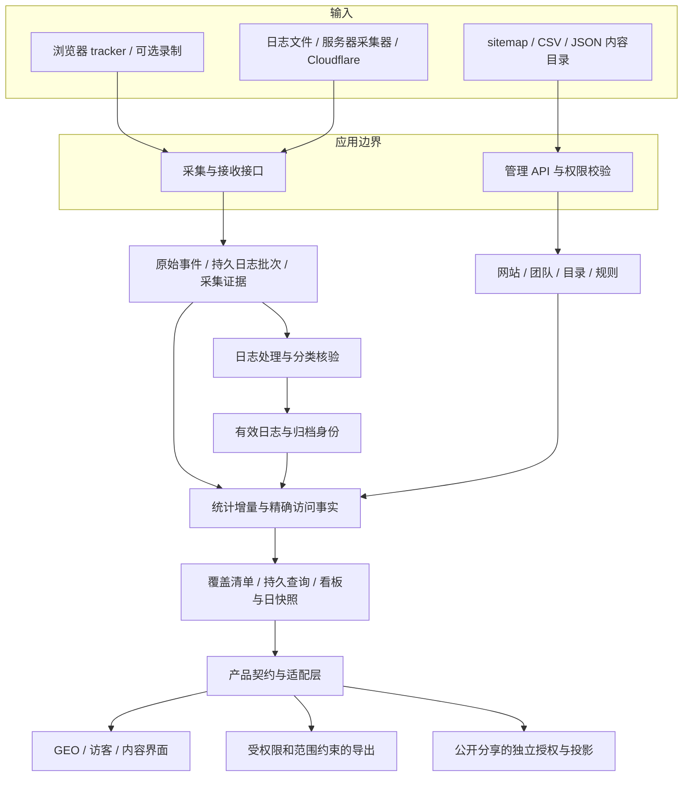
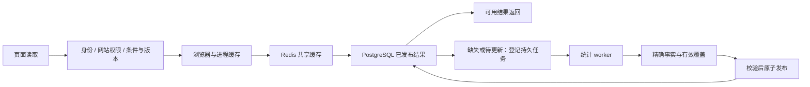

# GEOInflow 系统架构与数据原理

GEOInflow 为同一网站保存浏览器访问、服务器抓取日志和内容目录，并通过稳定的数据契约提供网站统计、AI 爬虫分析、内容观察和业务效果分析。

工程基于 Umami v3.4.1，登记的上游提交、迁移与 UI 清单位于 [`config/liekan/upstream.json`](../config/liekan/upstream.json)。`Liekan` 是继续保留的工程与部署标识，产品显示名称为 GEOInflow。

## 服务组成

标准部署使用同一应用镜像启动三个进程，并配套 PostgreSQL 和 Redis。

| 服务 | 职责 | 状态与存储 |
| --- | --- | --- |
| `app` | Next.js 页面、认证、权限、追踪接收和管理 API | 私有配置、主库与共享缓存 |
| `log-worker` | 日志批次处理、来源维护、爬虫证据与相关治理任务 | PostgreSQL 持久队列、批次及来源记录 |
| `analytics-worker` | 统计汇总、增量与历史构建、持久查询及 GEO 日结果 | PostgreSQL 任务、租约、覆盖和已发布结果 |
| `db` | 原始业务事实、权限、证据、队列、派生结果 | PostgreSQL 持久卷 |
| `analytics-cache` | 跨进程统计缓存及受控协调用途 | Redis，允许按容量淘汰和从持久数据恢复 |

Compose 新安装默认 PostgreSQL 16；已有 PostgreSQL 15 实例由部署脚本保留大版本与数据卷。Redis 缓存可以失效，PostgreSQL 中的任务和合法已发布结果用于继续读取与恢复。

## 三条数据路径

### 浏览器访问

浏览器 tracker 通过兼容的采集协议提交页面浏览、自定义事件及启用的扩展数据。原始事件、属性、收入、质量证据及可选 UUID 接收凭证在同一个事务提交。重复接收按既有规则处理，避免重试重复计数。

浏览 PV、UV、访问、跳出和时长使用统一的浏览总体与资格规则。可信入口、匿名身份依据和事件自身的环境快照影响身份类指标的可用性。缺少可靠身份时，页面保留 PV，并明确 UV 等指标的数据状态。

浏览器流量质量、服务器日志分类和人工治理分别保存。原始采集存在性与被统计纳入的总体各自有明确含义，方便核验安装、质量和统计差异。

### 服务器与 CDN 日志

手动导入与自动来源使用共同的解析、分类和核验规则。接收阶段验证网站与来源权限，限制批次大小和格式，完成脱敏后持久保存批次及队列任务，再返回持久确认。日志 worker 后续处理并更新可查询统计。

自动来源有独立的生效区间，手动与自动输入按来源区间处理重叠。服务器采集器保留加密缓冲、文件代次和确认位点，支持断网重传与受支持的日志轮转；覆盖缺口单独记录。

日志用于观察请求到达、身份声明、响应和路径。浏览器访问与日志请求分别计量；两者的差额需要在主机、目录、时间和来源覆盖可比时解释。

### 内容目录

sitemap、CSV 或 JSON 提供已知页面集合。系统将该集合与选定范围内的抓取日志核对，得到目录分布、访问覆盖和缺少观察记录的页面。

目录的完整性、更新时间、路径对应和日志覆盖影响解释。目录之外的真实日志仍然是观察事实；目录缺失时，完整站点覆盖率的分母保持不可用。

## 爬虫身份和证据

爬虫目录分别管理平台、产品、请求身份、用途、产品形态、引荐域名与官方资料。网站配置决定身份的启停和必要覆盖规则；全局目录通过草稿、差异预览和确认发布切换版本。

分类与来源核验保留独立结果：

| 层次 | 表达的事实 |
| --- | --- |
| UA 声明 | 请求携带与某个身份匹配的 User-Agent 标记 |
| 官方范围匹配 | 请求在核验时与已归档的适用地址范围一致 |
| DNS / 可信边缘证明 | 在已支持条件下记录独立核验方法与时间 |
| 来源覆盖 | 某个日志来源在指定观察区间内的连续性、缺口和处理状态 |
| 业务效果 | 浏览器实际引荐、落地页和目标转化 |

每次采集、统计、分页与导出绑定相应目录与规则版本。后续目录更新保留历史证据；未知和缺失不会据当前目录补造核验结果。身份、用途、产品形态与 AI 统计资格的具体规则见 [识别与统一管理](crawler-recognition.md)。

## 统计读取与后台计算

### 原始事实和精确派生层

日志按 UTC 五分钟和小时维护低基数汇总，路径、身份及浏览访问事实保留相应维度。访问级事实跨桶合并后计算 UV、访问、跳出与时长。跨天 UV 使用身份集合去重，直接相加每日 UV 会产生不同口径。

覆盖清单记录网站代次、统计语义、规则版本、输入修订和已验证区间。只有符合当前条件的覆盖才进入读取；当前尾部、失效区间和未覆盖部分由原始事实补齐。高级过滤、顺序、复杂漏斗等条件继续使用对应的精确查询。

迟到、补录、删除、质量更正和已确认治理变更会使相关覆盖或结果退出读取，再由后台重建。原始记录与核验证据按既有生命周期保存。

### 持久任务与计算准入

兼容的私有聚合查询可使用 `Prefer: respond-async`。有结果时返回原响应；首次计算返回 `202`、任务标识和重试间隔，页面等待后台完成后读取结果。

数据库保存业务任务的真实状态，pg-boss 提供持久唤醒与重试。任务在提交、执行、状态和结果读取时复核当前权限与网站代次；旧租约和旧版本任务不能发布结果。

普通看板、重分析与历史构建分别受准入和预算约束。当前前台需求优先，后台预热在低优先级执行，历史构建按短批次让出资源。无人查看的失败重任务停止无意义的反复重试。热力图等重分析保留自己的计算预算。

### 多层缓存和已发布结果

缓存身份包含网站、范围、时区、筛选、语言及相应数据与规则版本。数据和口径变化触发失效；普通读取不延长旧结果的原始有效期。

今日普通看板以 30 秒为短窗口，显示实际数据截止时间；重分析使用较长窗口。页面隐藏或离线时暂停自动读取，任务与数据库结果可以跨页面和进程恢复。已发布的合法结果可以在后台更新期间继续展示，并保留上次结果与更新状态。

常用今天、7 天、30 天预热使用与真实页面一致的条件。旧窗口按容量策略回收，活跃读者与在途生产者受到保护。午夜后尚未开始的预热可按前台短窗口提升，运行中任务与重试保持边界约束。

完整协议与预算见 [统计加速](analytics-acceleration.md) 和 [缓存](analytics-cache.md)。

## 日期、语言与快照

分析时区归属账户，默认 `Asia/Taipei`。首次完整登录确认国家及所在城市时区，界面语言单独保存。“今天”采用所选时区当前自然日的实际边界，覆盖夏令时的 23 / 25 小时及特殊午夜变化。

主要统计窗口使用今天、7 天、30 天及自定义范围。实时访客使用最近 30 分钟，留存使用所选自然月。已提交任务、导出和分享固定相应范围与时区；公开访问者的浏览器偏好不改变发布者的分享定义。

GEO 权重单独使用最近 30 个完整自然日，并以昨日作为当前计算截止日。其 Beta 政策、证据资格与不可变日快照与普通看板刷新分开维护。

## 权限与可选外部能力

网站资源具有个人或团队归属，查询及导出检查当前网站权限。管理、公共采集、公开分享和未完成二次验证的身份使用不同边界。分享停用、密码或范围变化会重新检查授权。

日志采集、Cloudflare 控制和 AI 模型连接使用各自的凭据与权限。Cloudflare 控制包含预览、确认、Zone 租约及未知结果只读核对；AI 分析只发送经过字段投影的有限网站事实，默认关闭。

地理库缺失时，采集继续工作，无法确定的地域保持缺失。外部服务的接入能力由配置、提供方权限和运行状态共同决定，相关页面展示实际原因。

## 源码入口

| 目录 | 职责 |
| --- | --- |
| `src/app` | Next.js 页面、API 路由与兼容入口 |
| `src/components/liekan` | GEOInflow 页面、导航与共享组件 |
| `src/lib/liekan/contracts` | 产品页面使用的数据契约与日期定义 |
| `src/lib/liekan/upstream` | 上游查询、认证、权限和统计适配 |
| `src/lib/liekan/crawlers` | 爬虫目录、发布及身份逻辑 |
| `src/lib/liekan/log-ingestion` | 自动来源、批次接收和持久队列 |
| `src/lib/liekan/geo-weight` | GEO 权重政策与证据 |
| `src/lib/liekan/ai` | 模型连接、有限事实和分析任务 |
| `src/liekan-worker`、`src/liekan-agent` | 后台处理与服务器日志采集器 |
| `src/tracker`、`src/recorder` | 浏览采集与可选录制 |
| `prisma`、`db/liekan/migrations` | 上游结构与独立增量迁移 |
| `packages` | 保留兼容名称的 API 客户端与 MCP 包 |
| `config/liekan` | 上游基线、设计清单、迁移和核心覆写登记 |
| `scripts`、`tests` | 构建、数据准备与针对性验证 |

产品页面通过 Liekan 契约访问数据，上游依赖集中在适配层。必要的上游核心改动登记在 `config/liekan/core-overrides.json`。已应用的 SQL 迁移按完整文件名和校验值保持不可变，升级采用追加迁移。

部署从 [部署指南](deployment.md) 开始，开发约定见 [贡献指南](../CONTRIBUTING.md)。
